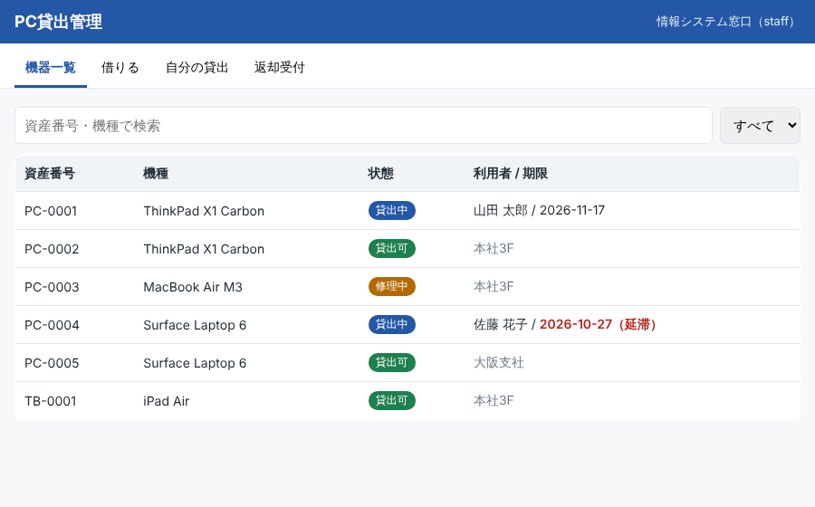
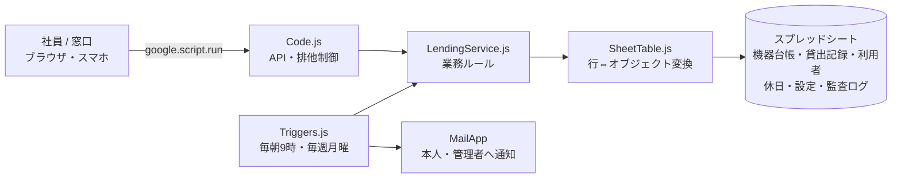

# PC Lending System (Google Apps Script)

**Googleスプレッドシートを台帳にした、社内PC・機器の貸出管理Webアプリ**

紙やExcelで管理していた貸出台帳を、追加費用ゼロ（Google Workspace のみ）でWebアプリ化しました。貸出・返却・延長の受付、返却期限のリマインド、延滞時の管理者エスカレーション、監査ログまでを自動化しています。

> English: A device-lending web app built on Google Apps Script with Google Sheets as the database. Role-based access, business-day due dates with a holiday calendar, script-lock concurrency control, idempotent reminder/escalation triggers, an append-only audit log, and 13 unit tests that run the unmodified GAS sources in Node.



---

## 解決した課題

| Before（手作業） | After（このシステム） |
|---|---|
| 誰が何を借りているか、台帳を開かないとわからない | 一覧画面で状態・利用者・期限をリアルタイム表示、延滞は赤字 |
| 返却期限の督促を担当者が個別にメール | 前日リマインド・延滞通知・管理者エスカレーションを毎朝自動送信 |
| 台帳の手入力ミス（「貸出可」の表記ゆれ等） | 状態・権限はプルダウン入力のみ、貸出・返却はアプリ経由 |
| 返却時の状態確認が記録に残らない | 窓口が「良好／要修理」を記録、要修理は自動で修理中へ |
| 変更履歴が追えない | すべての操作を編集不可の監査ログに記録 |

## 機能

- **貸出**：資産番号を入力して登録。返却期限は**土日・祝日を除いた営業日**で自動計算
- **代理貸出**：情シス窓口（staff）は他の社員の名義で貸出可能
- **返却受付**：窓口のみ。機器の状態を記録し、要修理なら台帳を「修理中」へ
- **延長**：最長貸出期間の範囲内で本人が申請可能（延滞中は不可）
- **通知**：毎朝9時に期限前日のリマインド・延滞通知、延滞3日で管理者へエスカレーション、毎週月曜に週次レポート
- **監査ログ**：誰が・いつ・何をしたかを保護シートに追記のみで記録

## 設計のポイント



| 観点 | 実装 |
|---|---|
| **同時操作** | 書き込みはすべて `LockService` のスクリプトロック内で実行。2人が同じPCを同時に登録しても二重貸出にならない |
| **データ整合性** | 台帳が手修正されて「貸出可」に戻っていても、未返却の貸出記録があれば貸出を拒否して管理者確認を促す |
| **権限** | `admin` / `staff` / `user` の3ロール。ログインユーザーはWorkspaceアカウントで判定し、本人以外の名義での貸出・返却受付は窓口のみ |
| **通知の重複防止** | 通知済み日時を記録し、トリガーが同日に再実行されても同じメールを送らない。エスカレーションは1回のみ |
| **性能** | シートは `getValues` で一括読み込み、1行単位で `setValues`。セル単位のループを避けてGASの実行時間・クォータを節約 |
| **エラー表示** | 業務ルール違反（上限超過など）はそのまま利用者へ表示し、想定外の例外は内部ログに残して画面には汎用メッセージのみ |
| **運用で変える値** | 貸出期間・通知タイミング・管理者アドレスは「設定」シート、祝日は「休日」シートで管理。コード修正不要 |

## テスト

GASはローカル実行できないため、`SpreadsheetApp`・`MailApp`・`LockService` などをメモリ上の偽物に差し替え、**本番と同じソースファイルをそのまま** Node.js の `vm` で読み込んでテストしています。

```bash
npm test     # 13 tests
```

| テスト | 検証内容 |
|---|---|
| 貸出 | 祝日・週末をまたぐ返却期限の計算、代理貸出の権限、上限台数、延滞者の貸出拒否、台帳と記録の不整合検知 |
| 返却・延長 | 窓口のみ受付可、要修理時の状態遷移、延滞日数の記録、最長期間を超える延長の拒否 |
| 通知 | 前日リマインド→延滞通知→3日後エスカレーションの流れ、同日再実行で重複送信しないこと |
| API | 業務エラーのメッセージ化、ロック競合時の応答、想定外エラーを画面に出さないこと |
| 保存 | 空行のスキップ、元の行への上書き、セットアップの冪等性 |

## 導入手順

```bash
npm install -g @google/clasp
clasp login

# スプレッドシートを新規作成し、拡張機能 → Apps Script でスクリプトIDを確認
cp .clasp.json.example .clasp.json   # scriptId を記入
clasp push
```

1. スプレッドシートを開き直し、メニュー「PC貸出管理 → 初期セットアップ」を実行
2. 「利用者」「機器台帳」「休日」シートにデータを登録、「設定」シートに管理者アドレスを入力
3. Apps Script エディタで「デプロイ → 新しいデプロイ → ウェブアプリ」（アクセス：組織内）
4. メニュー「通知トリガーを設定」を実行

### シート構成

| シート | 主な列 |
|---|---|
| 機器台帳 | 資産番号・機種・シリアル・分類・状態（貸出可/貸出中/修理中/廃棄）・保管場所 |
| 貸出記録 | 貸出ID・資産番号・借用者・目的・貸出日時・返却期限・返却日時・返却時状態・対応者 |
| 利用者 | メール・氏名・部署・権限（admin/staff/user）・同時貸出上限 |
| 休日 / 設定 | 祝日・会社休日 ／ 貸出期間・通知タイミング・管理者アドレス |
| 監査ログ | 日時・操作者・操作・対象・詳細（保護シート） |

## ファイル構成

```
src/
  Config.js           シート定義・状態・ロール・初期設定
  SheetTable.js       シートの行とオブジェクトの相互変換
  LendingService.js   貸出・返却・延長・通知判定の業務ルール
  Code.js             Webアプリ入口・API・排他制御・エラー処理
  Triggers.js         毎朝の通知、週次レポート
  Setup.js            初期セットアップ・メニュー・入力規則・シート保護
  Index.html / Styles.html / JavaScript.html   画面（スマホ対応）
test/
  gas-harness.js      GASサービスの模擬実装
  lending.test.js     ユニットテスト
```

## License

MIT
